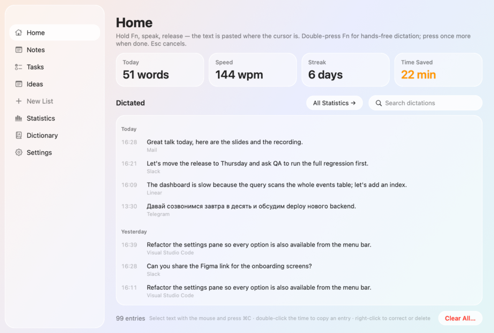
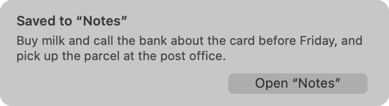
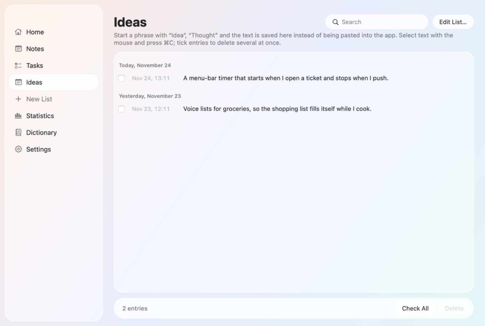
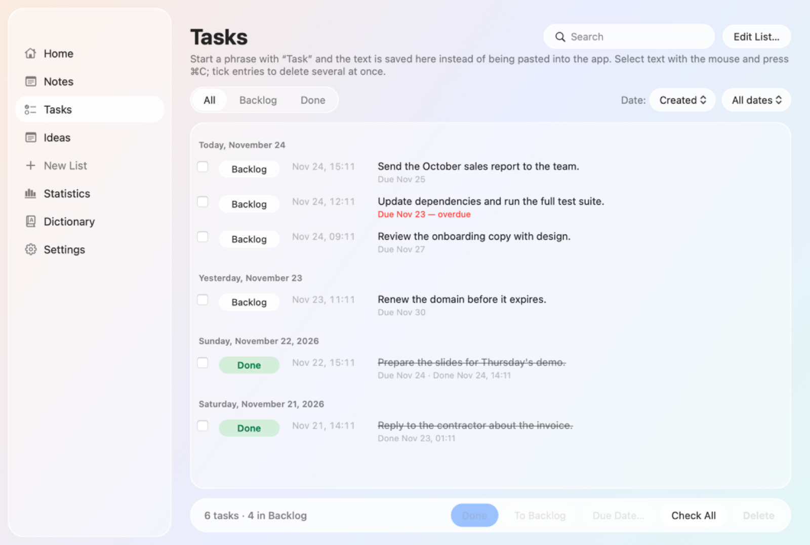
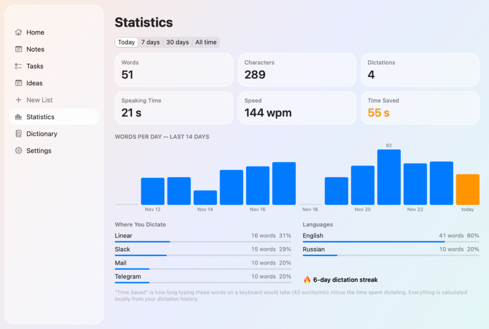
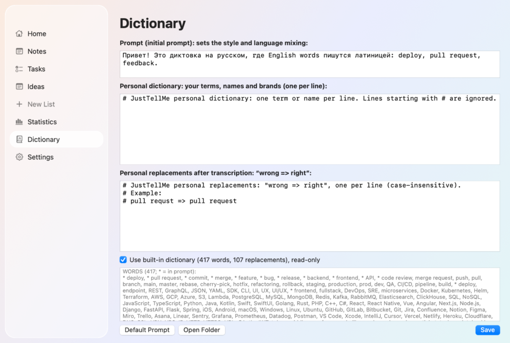
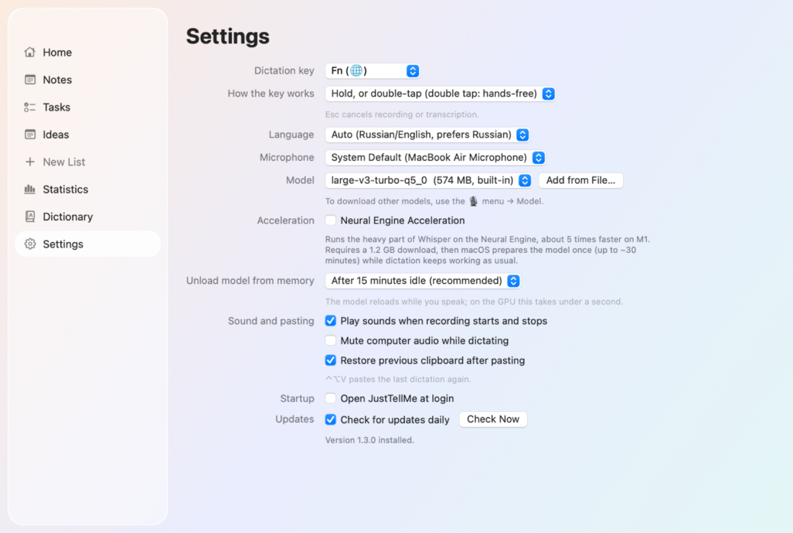

# JustTellMe

[](LICENSE)


[](https://github.com/Malashkin/JustTellMe/releases/latest)

**Private, offline dictation for macOS.** Hold a key, speak, release — your words are typed into whatever app you
are in. Say “Note: …” or “Task: …” and they land in your own lists instead.

Everything runs on your Mac with [whisper.cpp](https://github.com/ggml-org/whisper.cpp) on the GPU (Metal) or the
Neural Engine: no cloud, no account, no subscription. Recognition is tuned for Russian with English terms mixed in
(“посмотри мой pull request”) and works for English too. The interface follows the system language, English or Russian.



## Highlights

- **Dictate into any app.** Push-to-talk on Fn (🌐) or right ⌥, or double-tap for hands-free. The text appears about a second after you let go.
- **Voice lists.** Start a phrase with a command word and it is saved instead of pasted: notes, tasks with Backlog/Done and due dates, or any list you create.
- **Liquid Glass design.** The desktop shows through the window; panels, cards and controls are glass capsules, in Light and Dark mode.
- **Private by design.** Audio and text never leave the Mac. The large-v3-turbo model ships inside the app.
- **Light on resources.** The model leaves memory when you are idle and comes back in half a second while you speak.
- **Learns your words.** A personal dictionary, replacement rules, and “Correct and Remember…” that learns from your fixes.
- **Keeps itself current.** Checks GitHub Releases once a day and installs updates in two clicks, keeping your permissions.

## How it works

1. **Hold** Fn (or right ⌥) and speak. A small pill at the bottom of the screen shows your voice.

   

2. **Release.** Speech is recognised in pieces while you talk, so only the last few seconds remain.

   

3. **Done.** The text is pasted where the cursor is, and your clipboard is put back as it was.

Prefer not to hold a key? **Double-tap** it, speak as long as you like, and press once more to finish. **Esc** cancels at any time.

## Features

### Dictation that fits into any app

- **Push-to-talk or hands-free.** Hold to talk, or double-tap for hands-free. In Settings you can choose “tap once” instead of double-tap, or hold only.
- **Fast results.** Long speech is cut at pauses and recognised while you are still talking (about 0.6 s from release to text in our tests on an M3).
- **Clipboard-safe pasting.** The previous clipboard comes back after pasting, and clipboard managers (Maccy, Raycast, Paste) don't keep the dictated text.
- **Nothing gets lost.** If no text field was focused, a card shows the text with a **Copy** button. **⌃⌥V** pastes the last dictation again.
- **Russian + English in one phrase.** In Auto mode English terms stay in Latin script. You can also force Russian or English.
- **Pick your microphone.** You can choose a different microphone, and the app can mute other audio while you dictate.

### Voice lists: notes, tasks and your own

Start a dictation with a list's **command word** and the rest of the phrase goes to that list. Nothing is pasted.

| You say | Where it goes |
|---|---|
| “Note: call the bank before Friday.” | **Notes** — “Call the bank before Friday.” |
| “Task, send the October report.” | **Tasks**, in Backlog |
| “Idea: a menu-bar timer for tickets.” | **Ideas** — a list you created with the word “Idea” |
| «Заметка: купить молоко» (Russian system) | **Заметки** |

A card confirms where the text went, with a button to open the list:



- **Your own lists.** Click **New List** in the sidebar. Give the list a name and one or more command words separated by commas (“Idea, Thought”). Then choose its type: **Notes** for plain entries, or **Tasks**. **Edit List…** renames a list, changes its words or type, or deletes it.
- **Forgiving matching.**
  - Only the first word counts, so “This note is about…” is pasted as usual.
  - Command words of 6 letters or more still match when the recogniser gets one letter wrong or splits the word in two («Замевка», «За метка»).
  - Real words that merely look alike are excluded.
- **Every list** groups entries by day (“Today, November 24”). You can search it, select part of any entry and copy it with ⌘C, tick several entries and delete them at once, or right-click an entry to copy or delete it.



### Tasks



- **Backlog / Done** status per task, from the menu in front of it, for all ticked tasks at once, or from the right-click menu. Done tasks are struck through and remember when they were finished.
- **Due dates** come from a calendar. Overdue tasks are shown in red.
- **Filters:**
  - by status;
  - by date: **Created**, **Due** or **Done**;
  - by period: Today, 7 days, 30 days, All dates, or a **Custom range**.

  On **Due**, a period looks ahead (“what is due this week”) and always includes overdue tasks.

### History and statistics

Everything you dictate is kept on **Home**, grouped by day, with the app it went to. You can search it, copy an entry, correct it, or delete it.

**Statistics** shows, for today, 7 days, 30 days or all time:
- words and characters;
- dictations and speaking time;
- speed;
- time saved compared with typing;
- a words-per-day chart;
- the apps you dictate into and your languages;
- your daily streak.



### Dictionary and learning



- **Prompt.** An initial prompt that sets the style and how languages mix.
- **Personal dictionary.** Your names, brands and terms; they are fed to the recogniser.
- **Personal replacements.** Fixes applied after recognition, such as `пул реквест => pull request`.
- **Built-in dictionary.** About 400 popular English terms and 100 fixes for how they come out of Russian speech. It is read-only and you can turn it off.
- **Correct and Remember…** Fix the last phrase once. New words go to the dictionary, and changed fragments become replacements.

### Settings



Every option is also available from the 🎙 menu in the menu bar:
- the dictation key and how it works;
- language and microphone;
- the model (built-in, from a file, or downloaded);
- Neural Engine acceleration;
- when to unload the model;
- sounds, muting and clipboard restore;
- open at login and update checks.

## Requirements

- A Mac with Apple Silicon (M1–M4)
- macOS 13 Ventura or later
- About 1 GB of disk space; about 0.7 GB of memory while the model is loaded (it is unloaded when idle)

## Installation

1. Download `JustTellMe.zip` from the [latest release](https://github.com/Malashkin/JustTellMe/releases/latest) and unzip it into Applications.
2. First launch: right-click the app → **Open** (the app is signed but not notarized by Apple).
3. Allow **Microphone** and **Accessibility** when asked. The Home page shows what is still missing, with a button for each.

Updates then install from inside the app.

## Shortcuts and commands

| Action | How |
|---|---|
| Dictate (push-to-talk) | Hold **Fn** (or right **⌥**, set in Settings), speak, release |
| Dictate hands-free | Double-tap the key, speak, press once more |
| Cancel | **Esc** |
| Paste the last dictation again | **⌃⌥V** |
| Save to a list | Start the phrase with the list's command word: “Note …”, “Task …”, or your own |
| Open the main window | Click the app icon, or 🎙 → **Open JustTellMe…** |

## Privacy

- Recognition happens on your Mac. Audio and text never leave it; there is no telemetry and no account.
- The only network requests are the daily update check on GitHub (can be turned off), and downloads you start yourself: updates, other models, the Neural Engine encoder.
- Your data lives in `~/Library/Application Support/JustTellMe/`:
  - `history.json`;
  - `lists.json` and `list-<id>.json`;
  - your dictionary and replacements;
  - downloaded models.

  Delete the folder to remove everything.

See [docs/security](docs/security/index.md) for the details.

## Troubleshooting

| Problem | Fix |
|---|---|
| Nothing is pasted after an update | Open System Settings → Privacy & Security → Accessibility, remove JustTellMe with “−” and add it again. |
| Fn switches the keyboard layout or opens emoji | System Settings → Keyboard → “Press 🌐 key to” → **Do Nothing**, or use right ⌥ as the dictation key. |
| The first dictation with Neural Engine is slow | macOS prepares the Core ML model once (up to 30 minutes on M1); dictation keeps working on the GPU meanwhile. |
| A phrase went to a list by mistake | Remove or lengthen that command word in **Edit List…**; words shorter than 6 letters must be heard exactly. |
| The text went to the wrong window | Put the cursor where it belongs and press **⌃⌥V**. |

## Build from source

Requirements on the build machine: Xcode Command Line Tools, cmake, git, curl.

```bash
./build.sh            # → dist/JustTellMe.app and dist/JustTellMe.zip
SKIP_ZIP=1 ./build.sh # app only
```

`build.sh` clones whisper.cpp at a pinned commit, applies the patch from `patches/`, downloads the model and signs
the app. Run `scripts/make-signing-identity.sh` once, so macOS keeps the Microphone and Accessibility permissions
across rebuilds. Without it, remove and re-add JustTellMe in Accessibility after each rebuild
(`tccutil reset Accessibility com.justtellme.app`).

### Tests

```bash
scripts/test.sh                 # unit + integration, ~70 s (needs one ./build.sh first)
JTM_SKIP_SLOW=1 scripts/test.sh # fast: no speech recognition and no update-archive checks
```

Tests run in a temporary data folder and never touch your history or lists. Results are in [TEST_RESULTS.md](TEST_RESULTS.md).

### Releasing

1. Bump `CFBundleShortVersionString` in `Resources/Info.plist`.
2. Move the `[Unreleased]` CHANGELOG entries into a section for the new version.
3. Commit and push to `main`.
4. Run `scripts/release.sh`. It builds the app, runs all tests, tags the version and publishes a GitHub Release with `JustTellMe.zip`.

Installed apps pick the release up within a day. Releases must be signed with the same “JustTellMe Local Signing” certificate.

### Debug modes

The binary `JustTellMe.app/Contents/MacOS/JustTellMe` accepts hidden flags:
- `--transcribe file.wav [--lang] [--model] [--encoder] [--repeat N]`
- `--stream file.wav`: measures the wait after “release”
- `--learn "recognised" "corrected"`
- `--list-models`
- `--audio-info [--test-mute]`
- `--demo-paste "text"`
- `--demo-overlay [out.png]`
- `--demo-window out-prefix [--ok]`: PNGs of every page of the main window
- `--demo-card out.png`
- `--demo-note-card out.png`
- `--unload-cycle file.wav`
- `--focus-check [seconds]`
- `--update-check`
- `--update-stage file.zip [--version X]`
- `--update-install other/JustTellMe.app`

`JTM_LANG=en|ru` forces the interface language. `JTM_DEMO_DELAY=<seconds>` keeps each `--demo-window` page on screen longer. `JTM_SUPPORT_DIR=/path` uses another data folder.

### Project layout

| Path | What's there |
|---|---|
| `Sources/App` | Swift (AppKit, no Xcode project): menu, main window, hotkey, recording, streaming recognition, pasting, voice lists, dictionaries, statistics, localization (`L10n.swift`) |
| `Sources/Shim` | C wrapper around whisper.cpp |
| `Resources` | Info.plist, icon, built-in dictionary and replacements, `en.lproj` / `ru.lproj` |
| `patches` | Patch applied to whisper.cpp |
| `Tests` | Unit and integration tests (a small harness; no XCTest needed) |
| `docs` | Product, architecture and decisions (ADRs), build and release, tests, privacy, [CHANGELOG](docs/CHANGELOG.md) |

Contributors and coding agents: start with [docs/AGENTS.md](docs/AGENTS.md).

## License

[MIT](LICENSE). Third-party components: [whisper.cpp](https://github.com/ggml-org/whisper.cpp) (MIT),
[Whisper](https://github.com/openai/whisper) models (MIT), [Silero VAD](https://github.com/snakers4/silero-vad) (MIT).
