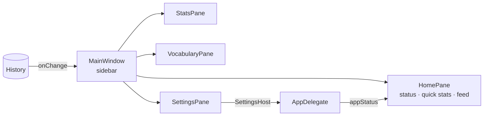

# Overview

A single-process AppKit app (`LSUIElement`, menu-bar only) built from `Sources/App/*.swift` with `swiftc`, plus a
C shim over a static whisper.cpp with Metal and Core ML. No nibs, no SwiftUI, no other dependencies.
The binary links only to system libraries, and `build.sh` checks this.

## Components

| File | Responsibility |
|---|---|
| `main.swift` | Entry point; hidden CLI modes (`--transcribe`, `--stream`, `--demo-window`, …) |
| `AppDelegate.swift` | State machine (loading/idle/recording/transcribing/error), menu-bar menu, wiring everything together |
| `Hotkey.swift` | `PushToTalkHotkey`: listen-only `CGEventTap` for Fn / right ⌥ down/up, Esc, combos (needs Accessibility); `GlobalShortcut`: Carbon hotkey for ⌃⌥V (no permission, consumes the key) |
| `Audio.swift` | `Recorder`: a fresh `AVAudioEngine` per recording at the device rate, preferred mic, levels for the overlay; `AudioUtil` resampling to 16 kHz |
| `Streaming.swift` | `StreamingDictation`: cuts long speech into pieces at pauses and sends them to Whisper while you talk |
| `Transcriber.swift` | Serial queue around the shim: load/unload model (+ optional Core ML encoder, attached in the background after an idle reload), transcribe, hallucination cleanup, script-based language label |
| `Sources/Shim/vf_whisper.c` | `vf_load`, `vf_transcribe`, `vf_uses_coreml`, `vf_warmup`, `vf_free` over whisper.cpp |
| `NeuralEngine.swift` | Download, unzip and prepare the Core ML encoder; status for the UI |
| `Vocabulary.swift` | Prompt, personal and built-in dictionary, replacement rules, casing of Latin terms |
| `Learning.swift` | `CorrectionLearner` (word diff → rules + terms); `Paths` (data folder) |
| `Paster.swift` | Clipboard round trip: lazy pasteboard promise, ⌘V, restore after the target app reads it; paste-again waits for ⌃⌥ to be released |
| `Focus.swift` | `FocusedField`: is a text field focused (Accessibility, errs towards "unknown"); `NoFieldCard` with «Скопировать» |
| `Updater.swift` | Daily check of the latest GitHub release; download, verify (bundle id, version, signature, same certificate), swap and relaunch |
| `History.swift` | `history.json` (newest first, 2000 max), change callback |
| `Stats.swift` | `DictationStats` (pure aggregates) and `StatsPane` (Статистика page) |
| `MainWindow.swift` | The main window: sidebar, `HomePane` (status, quick stats, feed) |
| `SettingsPane.swift` | Настройки page; `SettingsHost` protocol implemented by `AppDelegate` |
| `Windows.swift` | `VocabularyPane` (Словарь page), `CorrectionWindow` (fix and remember) |
| `Overlay.swift` | The recording pill; `WaveView` draws 18 CALayer bars at 30 fps |
| `Settings.swift` | `Prefs`, CoreAudio helpers, `SystemMute`, `SecureInput` |
| `Models.swift` | Bundled, imported and downloaded models; the active model |

## Dictation pipeline

```mermaid
sequenceDiagram
    participant K as Hotkey (CGEventTap)
    participant A as AppDelegate
    participant R as Recorder
    participant S as StreamingDictation
    participant W as Transcriber (whisper.cpp)
    participant P as Paster
    K->>A: key down
    A->>R: start (fresh AVAudioEngine, chosen mic)
    A->>S: new session (language, prompt)
    loop every 0.5 s while recording
        A->>S: poll()
        S->>S: ≥8 s pending? find a pause (≥0.3 s, piece ≥5 s; forced at 25 s)
        S->>W: transcribe piece (prompt + last 150 chars of the previous piece)
    end
    K->>A: key up (or second tap in hands-free mode)
    A->>R: stop
    A->>S: finish → last piece
    S->>W: transcribe remainder
    W-->>S: text (cleanup, replacements, casing)
    S-->>A: joined text + language
    A->>A: History.add
    A->>P: insert (clipboard promise + ⌘V, restore after read)
    A-->>A: FocusedField (background): no text field → NoFieldCard
```

Notes:
- Pieces run one at a time on the transcriber's serial queue. The language and prompt for a piece are decided on
  that queue, so they always see the previous piece's result. A piece that follows an English piece is decoded as English.
- `auto` decodes as Russian, with no separate detection pass. The language label comes from the script, counting words.
- After 15 idle minutes (default) the model is freed. Key down calls `prewarm()`: the model is loaded on the GPU only
  (~0.4 s, hidden by the speech). With Neural Engine on, after that dictation a second context with the Core ML
  encoder is loaded and warmed up (`vf_warmup`) on a background queue, then swapped in between dictations. See [ADR 006](decisions/006-unload-when-idle.md).
- With Neural Engine on, the encoder runs through Core ML (`JTM_COREML_ENCODER`). In that case the shorter
  audio-context trick is disabled, because Core ML encoders have a fixed 1500 context.

## Main window



## Updates

```mermaid
sequenceDiagram
    participant U as Updater
    participant G as api.github.com
    participant D as GitHub Releases
    U->>G: GET /repos/Malashkin/JustTellMe/releases/latest (daily)
    G-->>U: tag, notes, JustTellMe.zip URL
    U->>U: newer than CFBundleShortVersionString? → menu + Главная
    U->>D: download JustTellMe.zip (after «Установить»)
    U->>U: ditto -x; same bundle id, same version as tag; codesign --verify; same certificate (designated requirement)
    U->>U: sh: wait for exit → swap the .app (roll back on failure) → open
```

See [ADR 007](decisions/007-updates-from-github-releases.md).

## Data on disk

`~/Library/Application Support/JustTellMe/` (or `$JTM_SUPPORT_DIR`): `history.json`, `dictionary.txt`,
`replacements.txt`, `prompt.txt` (only when customised), `Models/` (downloaded models and Core ML encoders).
See [security/](../security/index.md).
