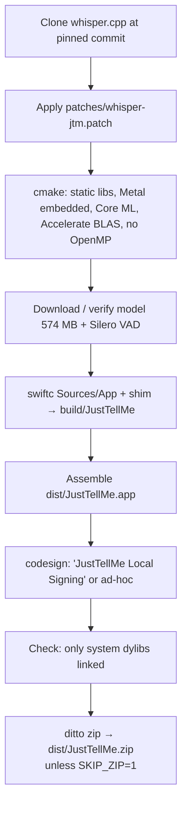

# Build & release

How to build, sign, install and hand JustTellMe to another Mac. Up: [AGENTS.md](../AGENTS.md).

## Requirements (build machine only)

Apple Silicon, macOS 13 or later, Xcode Command Line Tools, cmake, git and curl. The target Mac needs nothing extra.

## What `build.sh` does



- The whisper.cpp commit, model name, size and VAD checksum are pinned at the top of `build.sh`.
- The model is reused from `models/` or `build/model/` when the size matches.
- The patch adds `whisper_set_audio_ctx`, Core ML only on request (`JTM_COREML_ENCODER`), and `whisper_uses_coreml()`. It is applied only if missing.

## Signing

Run `scripts/make-signing-identity.sh` once. It creates a self-signed "JustTellMe Local Signing" identity in the login
keychain. With it, macOS keeps the Accessibility and Microphone grants across rebuilds. Without it, `build.sh` signs
ad-hoc, and you need to re-grant Accessibility after every build. Override the identity with `SIGN_ID=...`.

## Release

1. Bump `CFBundleShortVersionString` (and `CFBundleVersion`) in `Resources/Info.plist`.
2. Move the `[Unreleased]` entries in `docs/CHANGELOG.md` under `## [X.Y.Z] — date`.
3. Commit and push, then run `scripts/release.sh`. It:
   - refuses if the tree is dirty, not pushed, or the tag exists;
   - builds with the zip, runs the full test suite;
   - tags `vX.Y.Z` and creates the GitHub Release with `dist/JustTellMe.zip` and that CHANGELOG section as notes.

Installed apps see the release within a day (or at once with «Проверить сейчас»). They install it themselves: see
[ADR 007](../architecture/decisions/007-updates-from-github-releases.md). Build releases only on the machine that has
the «JustTellMe Local Signing» certificate.

## Install / update by hand

```bash
osascript -e 'quit app "JustTellMe"'
rm -rf /Applications/JustTellMe.app && ditto dist/JustTellMe.app /Applications/JustTellMe.app
open /Applications/JustTellMe.app
```

After an update:
- If the home page says Accessibility is missing, remove JustTellMe with «−» and add it again.
- With Neural Engine on, macOS may prepare the encoder again (15–25 min in the background).

## Another Mac

Download `JustTellMe.zip` from [Releases](https://github.com/Malashkin/JustTellMe/releases/latest), unzip it into
Applications, then right-click → Open (the app is not notarized, so the first launch needs this once).
Then grant Microphone and Accessibility. Later versions install from the app itself.
